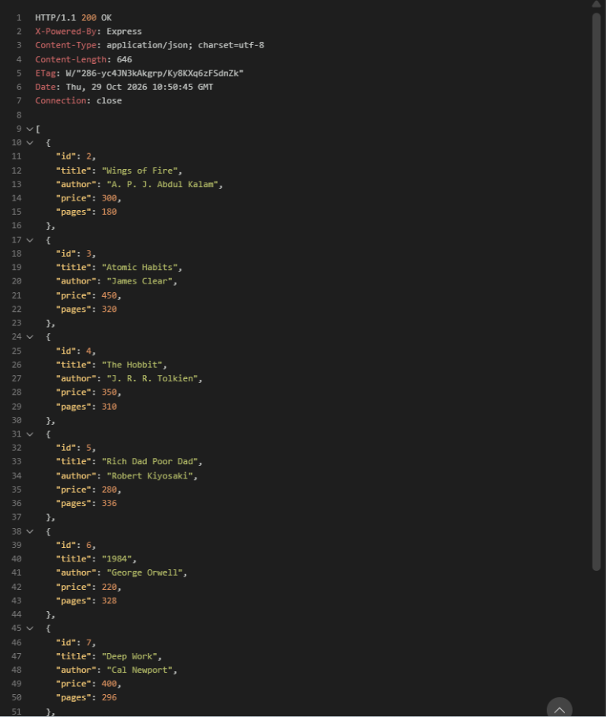
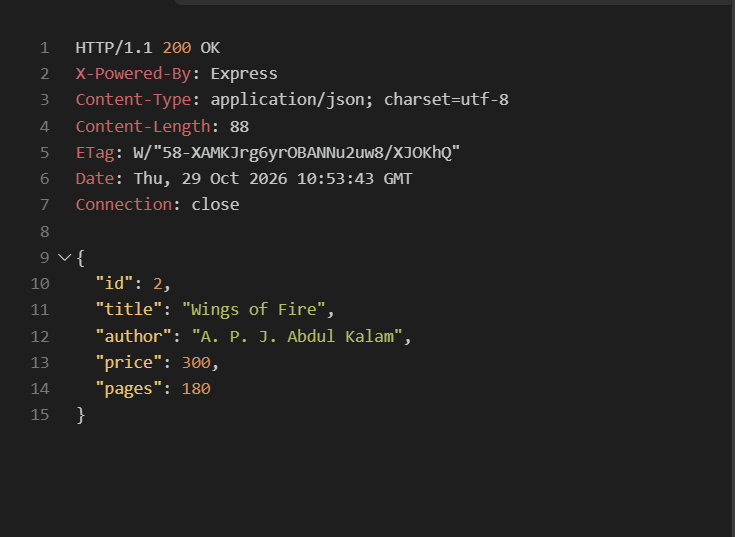
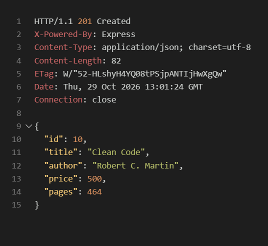
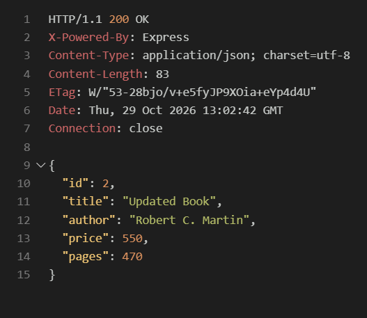
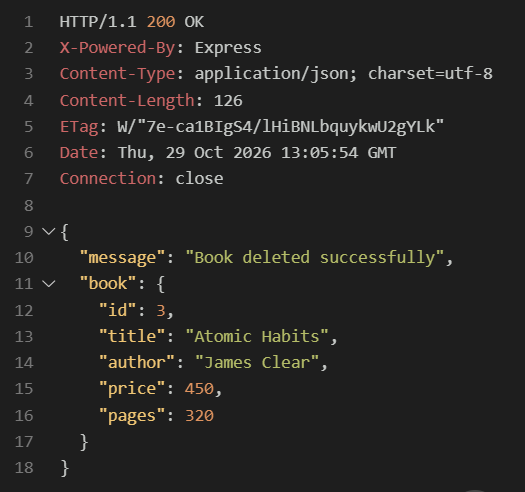
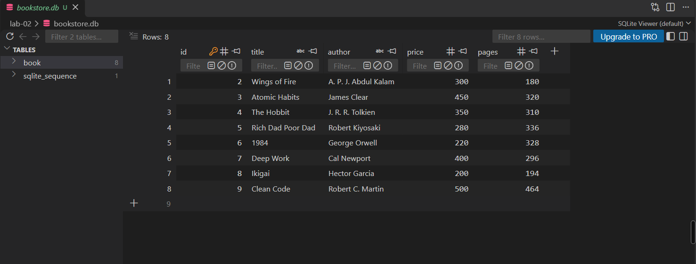

# Lab 2: SQLite Database and CRUD Routes

## Course Information

| Field      | Details                          |
| ---------- | -------------------------------- |
| Course     | Backend Development Fundamentals |
| Year/Term  | Year II, Term II                 |
| University | Aurora Deemed to be University   |
| Faculty    | Mr. Joel Prashanth D             |

## Student Details

| Field               | Details           |
| ------------------- | ----------------- |
| Name                | Bakkathatla Shiva |
| Registration Number | 252U1R9175        |
| Section             | S-26              |

## Project Overview

This project connects an Express.js server to an SQLite database and exposes HTTP routes for performing Create, Read, Update, and Delete (CRUD) operations on book records.

**Live deployment URL:** https://backend-labs-4-iu90.onrender.com/books

## Project Objective

To connect an Express.js server to an SQLite database and implement CRUD operations over HTTP using asynchronous database operations, parameterized SQL queries, input validation, and appropriate HTTP status codes.

## Technologies Used

- [Node.js](https://nodejs.org/)
- [Express.js](https://expressjs.com/)
- [SQLite](https://www.sqlite.org/)
- `sqlite3`
- `sqlite`
- [Nodemon](https://nodemon.io/)
- [Postman](https://www.postman.com/)

## Features

1. Initializes the SQLite database and creates the `book` table if it does not exist.
2. Inserts eight sample book records when the table is empty.
3. Retrieves all books.
4. Retrieves a single book by ID.
5. Adds a new book.
6. Updates an existing book.
7. Deletes a book.
8. Uses `async`/`await` for database operations.
9. Uses parameterized SQL queries with `?` placeholders to help prevent SQL injection.
10. Validates request data, returns appropriate HTTP status codes, and handles database errors.

## Database Schema

The `book` table contains the following columns:

| Column   | Type      | Description                     |
| -------- | --------- | ------------------------------- |
| `id`     | `INTEGER` | Primary key with auto-increment |
| `title`  | `TEXT`    | Book title; required            |
| `author` | `TEXT`    | Book author; required           |
| `price`  | `INTEGER` | Non-negative book price         |
| `pages`  | `INTEGER` | Positive number of pages        |

## API Endpoints

| Method   | Endpoint          | Description             | Success Status |
| -------- | ----------------- | ----------------------- | -------------: |
| `GET`    | `/books/`         | Retrieve all books      |          `200` |
| `GET`    | `/books/:bookId/` | Retrieve a book by ID   |          `200` |
| `POST`   | `/books/`         | Add a new book          |          `201` |
| `PUT`    | `/books/:bookId/` | Update an existing book |          `200` |
| `DELETE` | `/books/:bookId/` | Delete a book           |          `200` |

### Request Body

`POST /books/` and `PUT /books/:bookId/` require a JSON request body with the following fields:

```json
{
  "title": "Clean Code",
  "author": "Robert C. Martin",
  "price": 500,
  "pages": 464
}
```

The `title` and `author` must be non-empty strings. The `price` must be a non-negative integer, and `pages` must be a positive integer.

### Response and Error Status Codes

| Situation                           |                 Status Code |
| ----------------------------------- | --------------------------: |
| Successful `GET` request            |                    `200 OK` |
| Successful `POST` request           |               `201 Created` |
| Successful `PUT` request            |                    `200 OK` |
| Successful `DELETE` request         |                    `200 OK` |
| Invalid input                       |           `400 Bad Request` |
| Book not found                      |             `404 Not Found` |
| Unexpected server or database error | `500 Internal Server Error` |

## Project Structure

```text
lab-02/
├── app.js
├── bookstore.db
├── package.json
├── package-lock.json
├── .gitignore
├── README.md
└── screenshots/
    ├── get-all-books.png
    ├── get-single-book.png
    ├── post-book.png
    ├── put-book.png
    ├── delete-book.png
    └── database-view.png
```

## Installation and Running

### Prerequisites

- Node.js and npm installed on the system.
- Postman installed for API testing.

### Install dependencies

Open a terminal in the `lab-02` directory and run:

```bash
npm install
```

### Start the development server

```bash
npm run dev
```

The server runs at:

```text
http://localhost:3000
```

The SQLite database is initialized automatically by `app.js`. On startup, the application creates the `book` table if necessary and inserts the eight sample records only when the table is empty.

The `start` script can also be used to run the application without Nodemon:

```bash
npm start
```

## Postman Testing

1. Start the server with `npm run dev`.
2. Open Postman.
3. Create requests using `http://localhost:3000` as the base URL.
4. For `POST` and `PUT` requests, select **Body** → **raw** → **JSON** and use the sample request body shown below.
5. Send each request and verify the response body and status code.

### 1. Retrieve all books

- **Method:** `GET`
- **URL:** `http://localhost:3000/books/`
- **Expected status:** `200 OK`

### 2. Retrieve a single book

- **Method:** `GET`
- **URL:** `http://localhost:3000/books/1/`
- **Expected status:** `200 OK`

Replace `1` with the ID of the book to retrieve. An ID that does not exist returns `404 Not Found`.

### 3. Add a new book

- **Method:** `POST`
- **URL:** `http://localhost:3000/books/`
- **Header:** `Content-Type: application/json`
- **Expected status:** `201 Created`

```json
{
  "title": "Clean Code",
  "author": "Robert C. Martin",
  "price": 500,
  "pages": 464
}
```

### 4. Update an existing book

- **Method:** `PUT`
- **URL:** `http://localhost:3000/books/1/`
- **Header:** `Content-Type: application/json`
- **Expected status:** `200 OK`

```json
{
  "title": "Clean Code",
  "author": "Robert C. Martin",
  "price": 500,
  "pages": 464
}
```

Replace `1` with the ID of the book to update. The request body contains the complete updated book record.

### 5. Delete a book

- **Method:** `DELETE`
- **URL:** `http://localhost:3000/books/1/`
- **Expected status:** `200 OK`

Replace `1` with the ID of the book to delete. An ID that does not exist returns `404 Not Found`.

### Invalid-input testing

Send an incomplete or invalid request body to `POST /books/` or `PUT /books/:bookId/`, for example:

```json
{
  "title": "",
  "author": "Robert C. Martin",
  "price": -10,
  "pages": 0
}
```

The expected response status is `400 Bad Request`.

## REST Client Testing and Screenshot Capture

This project includes [`app.http`](./app.http), which can be used with the **REST Client** extension in VS Code. The six request blocks are separated with `###`, so each request can be executed independently.

### Run the requests

1. Open the `lab-02` folder in VS Code.
2. Make sure the server is running:

   ```bash
   npm run dev
   ```

3. Open [`app.http`](./app.http).
4. Hover over the request you want to test and select **Send Request**.
5. REST Client opens the response in a VS Code editor tab. Confirm the status line and response body before taking the screenshot.
6. To repeat a request, select **Send Request** for that request block again.

Run the request blocks in this order:

| Screenshot | Request block | Expected result |
| --- | --- | --- |
| `get-all-books.png` | `GET http://localhost:3000/books/` | `200 OK` and a JSON array |
| `get-single-book.png` | `GET http://localhost:3000/books/1/` | `200 OK` and one book object |
| `post-book.png` | `POST http://localhost:3000/books/` | `201 Created` and the created book |
| `put-book.png` | `PUT http://localhost:3000/books/1/` | `200 OK` and the updated book |
| `delete-book.png` | `DELETE http://localhost:3000/books/1/` | `200 OK` and a deletion confirmation |

The `POST` request includes the sample JSON body in `app.http`. The `PUT` request includes an updated JSON body. If the `PUT` or `DELETE` request is run after deleting book ID `1`, first recreate a test book or change the ID to an existing book so the response can be captured with the expected status.


## Screenshots

The following images must be captured from the running project and saved in the `screenshots/` directory before submission:

### Get all books



### Get a single book



### Add a book



### Update a book



### Delete a book



### Database view


## Problems Faced and Solutions

| Problem Faced                                                     | Solution                                                                 |
| ----------------------------------------------------------------- | ------------------------------------------------------------------------ |
| Difficulty installing and configuring SQLite3 with Node.js.       | Installed the required packages and configured the database connection correctly. |
| Errors while testing GET, POST, PUT, and DELETE endpoints.        | Corrected API routes, request parameters, HTTP methods, and SQL queries. |
| GitHub push errors due to an incorrect remote URL.                | Verified the Git remote URL and configured the correct repository.       |
| Render deployment failed because of an incorrect root directory.   | Set the root directory to `lab-02` and configured the correct build and start commands. |
| GLIBC compatibility error while running SQLite3 on Render.         | Updated the SQLite3 dependency and attempted to rebuild the native module from source. |

